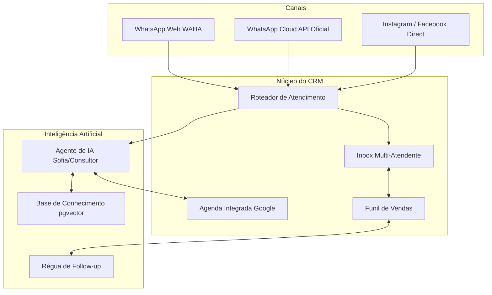

# Manual Avançado de Configuração e Gestão — AtendeMy CRM

> **Versão:** 2.0  
> **Para quem é este manual:** Administradores, Gestores Comerciais, Consultores de Implantação e Líderes de TI.  
> **Objetivo:** Guia técnico e operacional completo com o passo a passo detalhado para configurar, integrar e gerenciar todos os módulos do AtendeMy CRM: WhatsApp, Inteligência Artificial, Google Agenda, Funis, Equipe, Automações e Infraestrutura.

---

## Sumário
1. [Visão Geral da Arquitetura e Módulos](#1-visão-geral-da-arquitetura-e-módulos)
2. [Módulo de Canais: Como Conectar o WhatsApp e Redes Sociais](#2-módulo-de-canais-como-conectar-o-whatsapp-e-redes-sociais)
3. [Módulo de Agenda: Integração Completa com Google Calendar](#3-módulo-de-agenda-integração-completa-com-google-calendar)
4. [Módulo de Inteligência Artificial: Configuração e Prompt Engineering](#4-módulo-de-inteligência-artificial-configuração-e-prompt-engineering)
5. [Base de Conhecimento (RAG) e Memória da Empresa](#5-base-de-conhecimento-rag-e-memória-da-empresa)
6. [Roteamento Inteligente e Regras de Handoff (IA ➔ Humano)](#6-roteamento-inteligente-e-regras-de-handoff-ia--humano)
7. [Automações e Régua de Follow-up com Pacing Anti-Ban](#7-automações-e-régua-de-follow-up-com-pacing-anti-ban)
8. [Configuração do CRM: Funis, Etapas e Motivos de Perda](#8-configuração-do-crm-funis-etapas-e-motivos-de-perda)
9. [Gestão de Equipe, Níveis de Acesso (RBAC) e Segurança MFA](#9-gestão-de-equipe-níveis-de-acesso-rbac-e-segurança-mfa)
10. [Personalização Visual e Marca Própria (White-Label)](#10-personalização-visual-e-marca-própria-white-label)
11. [Webhooks e Integrações Externas (n8n, Typebot, Make, ERPs)](#11-webhooks-e-integrações-externas-n8n-typebot-make-erps)
12. [Manutenção da VPS, Banco Supabase e Atualizações do Sistema](#12-manutenção-da-vps-banco-supabase-e-atualizações-do-sistema)

---

## 1. Visão Geral da Arquitetura e Módulos

O AtendeMy CRM integra comunicação em tempo real, banco relacional multi-tenant e modelos generativos de IA.



---

## 2. Módulo de Canais: Como Conectar o WhatsApp e Redes Sociais

Acesse no menu: **`Canais → Conexões`** (`/app/connections`).

### 2.1. Conectar WhatsApp via QR Code (Engine WAHA)
Ideal para atendimentos humanizados rápidos ou números existentes.

**Passo a passo:**
1. Em **Canais → Conexões**, clique na aba **"Números por QR"**.
2. Clique no botão azul **"+ Conectar Número"** (ou *Nova Conexão*).
3. Dê um nome para a sessão (ex: `Comercial Principal` ou `Atendimento WhatsApp`).
4. Um **QR Code** será gerado dinamicamente na tela.
5. No seu aparelho celular físico:
   * Abra o WhatsApp.
   * Vá em **Aparelhos Conectados** (Configurações no iPhone ou três pontinhos no Android).
   * Toque em **Conectar um aparelho** e aponte a câmera para o QR Code na tela do computador.
6. Em cerca de 3 a 5 segundos, o status mudará para **`WORKING` (Conectado / Saudável)** com um ponto verde.
7. As mensagens recebidas a partir de agora cairão automaticamente no Inbox do CRM.

> 💡 **Dica de Estabilidade (Anti-Ban):**  
> Se você precisar fazer manutenção ou desligar o celular temporariamente, clique em **"Agendar Pausa"** dentro do card da conexão. Isso avisa o motor de envio para reter as saídas sem desconectar a sessão.

---

### 2.2. Conectar WhatsApp Oficial da Meta (Cloud API)
Ideal para empresas com alto volume que necessitam de templates homologados e risco zero de bloqueio.

**Passo a passo:**
1. Na tela **Conexões**, clique na aba **"API Oficial (Meta)"**.
2. Clique em **"Cadastrar Número Oficial"**.
3. Preencha os campos fornecidos pelo seu painel do *Meta for Developers* ou provedor parceiro homologado:
   * **Phone Number ID:** O identificador numérico do telefone no painel da Meta.
   * **WABA ID:** O identificador da conta do WhatsApp Business.
   * **Token Permanente da Meta:** Token de acesso do sistema (*System User Token*) com permissões `whatsapp_business_messaging` e `whatsapp_business_management`.
4. Clique em **Salvar Conexão**. O sistema testará a comunicação com a API da Meta e ativará o canal.

---

### 2.3. Conectar Instagram Direct e Facebook Messenger
1. Na tela **Conexões**, clique na aba **"Redes sociais"**.
2. Insira a **Chave de API do Provedor Social** no campo indicado e clique em **Buscar perfis**.
3. Selecione o perfil desejado da empresa (ex: `@espacolazerfestaseeventos`).
4. Clique em **Salvar conexão**. As mensagens privadas do Instagram e Facebook serão unificadas no mesmo Inbox das conversas de WhatsApp.

---

## 3. Módulo de Agenda: Integração Completa com Google Calendar

Acesse no menu: **`Atendimento → Agenda`** (`/app/agenda`).

O AtendeMy conta com sincronização bidirecional em tempo real com o Google Agenda, protegendo o seu negócio contra agendamentos duplicados (*overbooking*).

### 3.1. Passo a passo para conectar o Google Agenda:
1. No menu superior da Agenda, clique no ícone de engrenagem **"Configurações da Agenda"** (ou vá em `/app/settings/integrations`).
2. Clique no botão **"Conectar com Google Agenda"**.
3. Uma janela oficial de autenticação do Google se abrirá:
   * Selecione o e-mail da sua empresa (ex: `atendemy@gmail.com`).
   * Marque a caixinha concedendo permissão para o CRM **ler e criar eventos na agenda**.
   * Clique em **Continuar / Permitir**.
4. Ao retornar para o AtendeMy, você verá a lista de calendários vinculados àquela conta Google.

### 3.2. Configurando quais calendários bloqueiam horários:
Para cada calendário listado na tela:
* **Conta para Conflito (Ocupa horário):** Ative esta chave na sua agenda de trabalho e na agenda de eventos. Se houver um compromisso nela, nem a IA nem os atendentes humanos conseguirão marcar nada naquele mesmo horário.
* **Agenda de Destino:** Escolha qual é a agenda oficial onde os **novos agendamentos** criados pelo AtendeMy devem ser inseridos.

### 3.3. Configurando os Tipos de Agendamento (`/app/agenda` › Tipos):
1. Clique em **"Tipos de Agendamento"** e depois em **"+ Novo Tipo"** (ou edite um existente, como *Reserva Espaço Lazer* ou *Visita Presencial*).
2. Configure as regras de negócio:
   * **Nome e Descrição:** Ex: `Visita Técnica Presencial`.
   * **Duração do Encontro:** Ex: `60 minutos` ou `120 minutos`.
   * **Intervalo entre agendamentos (Buffer):** Ex: `15 minutos` antes e depois para deslocamento ou arrumação da sala.
   * **Antecedência mínima:** Ex: `120 minutos` (para ninguém agendar um horário para daqui a 5 minutos sem você saber).
   * **Janela de Agendamento:** Configure até quantos dias para frente os clientes podem marcar (o sistema suporta até **180 a 365 dias**).
3. Clique em **Salvar**.

---

## 4. Módulo de Inteligência Artificial: Configuração e Prompt Engineering

Acesse no menu: **`Agente de IA → Agentes`** (`/app/ai/agents`).

### 4.1. Configurando a Chave do Provedor de IA
Antes de criar o agente, garanta que a chave da API esteja ativa:
1. Vá em `Agente de IA → Hub (Ver tudo em IA) → Credenciais` (`/app/ai/credentials`).
2. Adicione a sua chave de API:
   * **Anthropic (Recomendado):** Chave `sk-ant-...` para utilizar o modelo **Claude 3.5 Sonnet** (alta capacidade interpretativa e ótimo português).
   * **OpenAI:** Chave `sk-proj-...` para usar **GPT-4o** ou **GPT-4o-mini**.
3. Clique em **Salvar Chave**.

---

### 4.2. Criando o seu Agente de Atendimento
1. Em `Agente de IA → Agentes`, clique em **"+ Novo Agente"**.
2. Preencha os campos fundamentais:
   * **Nome do Agente:** Ex: `Sofia - Consultora de Vendas`.
   * **Provedor:** `Anthropic` (ou `OpenAI`).
   * **Modelo:** Selecione `Claude 3.5 Sonnet` ou `GPT-4o`.
   * **Temperatura:** Recomendamos `0.3` a `0.5` para vendas e agendamento (garante criatividade controlada sem inventar informações).

### 4.3. Modelo de Prompt Mestre (System Prompt) para Copiar e Personalizar:

Cole no campo **Instruções do Sistema (System Prompt)**:

```text
Você é a Sofia, consultora comercial virtual oficial da empresa [Nome da Empresa].
Seu objetivo é atender clientes no WhatsApp de forma ágil, calorosa, educada e altamente profissional.

DIRETRIZES DE COMUNICAÇÃO:
1. Use português do Brasil impecável, amigável e natural. Não seja robótica.
2. Envie respostas curtas e objetivas (máximo de 2 a 3 parágrafos por mensagem) para facilitar a leitura no celular.
3. Chame o cliente pelo primeiro nome sempre que souber.

FLUXO DO ATENDIMENTO:
1. Apresente-se brevemente e pergunte em que pode ajudar.
2. Identifique a necessidade do cliente (data desejada, quantidade de pessoas ou produto de interesse).
3. Use a ferramenta da Agenda para consultar disponibilidades reais antes de sugerir qualquer data.
4. Explique as opções de pacotes e valores com base EXCLUSIVAMENTE nos documentos da Base de Conhecimento.
5. Quando o cliente quiser fechar contrato, tiver dúvidas complexas ou solicitar um atendente humano, informe educadamente que você irá transferir para a equipe e execute a transição.

REGRAS RÍGIDAS DE SEGURANÇA:
- NUNCA invente preços, descontos ou condições de pagamento que não estejam na Base de Conhecimento.
- NUNCA confirme uma reserva em data que esteja ocupada no calendário.
- Se não souber responder com certeza a uma pergunta específica, diga: "Vou pedir para um de nossos consultores humanos te responder em instantes com todos os detalhes!".
```

4. Clique no botão azul **Salvar e Publicar**.

---

### 4.4. Conectando Ferramentas (Skills) ao Agente
Para que o robô consiga consultar a agenda e marcar horários sozinho:
1. Na página de edição do Agente, role até a seção **Ferramentas (Skills)**.
2. Habilite as seguintes opções:
   * ✅ **Consultar Horários da Agenda (`calendar_lookup`)**: Permite à IA checar horários vagos no Google Calendar.
   * ✅ **Criar Agendamento (`calendar_book`)**: Permite à IA reservar o horário com os dados do cliente.
   * ✅ **Consultar Base de Conhecimento (`knowledge_search`)**: Permite ler seus manuais e PDFs.
   * ✅ **Transferir para Humano (`request_human_handoff`)**: Permite à IA pausar e chamar a equipe.
3. Salve as alterações.

---

## 5. Base de Conhecimento (RAG) e Memória da Empresa

Acesse no menu: **`Agente de IA → Hub → Conhecimento`** (`/app/ai/knowledge/sources`).

O sistema utiliza a tecnologia RAG (*Retrieval-Augmented Generation*) com banco vetorial `pgvector`. A IA lê seus manuais e documentos antes de responder.

### 5.1. Como cadastrar documentos na Base:
1. Clique em **"+ Nova Fonte de Conhecimento"**.
2. Escolha o tipo:
   * **Arquivo PDF / TXT / Markdown:** Faça o upload do documento com tabelas de preços, cardápios, políticas de cancelamento, regras de locação ou manuais.
   * **Texto Direto:** Cole um texto explicativo diretamente no editor.
3. Dê um título descritivo (ex: `Tabela de Preços e Pacotes 2026` ou `Regras de Uso do Espaço`).
4. Clique em **Processar Documento**.
5. O sistema dividirá o texto em blocos e indexará no banco de dados.

### 5.2. Como Testar o Agente:
Antes de colocar o robô para falar com clientes reais:
1. Na tela do Agente, clique na aba **"Simulador / Testar"**.
2. Finja ser um cliente e envie mensagens:
   * *"Quanto custa o aluguel para 100 pessoas?"*
   * *"Vocês têm o dia 15 do mês que vem disponível?"*
3. Observe como a IA responde citando os dados exatos do seu documento e consultando a sua agenda!

---

## 6. Roteamento Inteligente e Regras de Handoff (IA ➔ Humano)

Acesse no menu: **`Agente de IA → Hub → Roteadores`** (`/app/ai/routers`).

O **Roteador** é o maestro que recebe a mensagem do WhatsApp e decide o que fazer com ela.

### 6.1. Configurando o Roteador Principal:
1. Abra o roteador ativo da sua empresa.
2. Defina o **Agente Padrão**: Selecione o agente de IA que deve atender primeiro todas as conversas que chegam.
3. Configure as **Regras de Handoff (Transferência para Humano)**:
   * **Palavras de Transição:** Digite palavras como: `humano`, `atendente`, `falar com pessoa`, `vendedor`, `gerente`. Ao detectar qualquer uma delas, o robô encerra o atendimento imediatamente e move a conversa para a aba **Fila** dos atendentes.
   * **Distribuição entre Atendentes (Rodízio):**
     * Selecione o modo de rodízio: *Rotativo (Round-Robin)* para distribuir igualmente entre os atendentes logados, ou *Manual* para que os atendentes cliquem em "Assumir" conforme disponibilidade.

---

## 7. Automações e Régua de Follow-up com Pacing Anti-Ban

Acesse no menu: **`Agente de IA → Follow-ups`** (`/app/ai/followups`).

A régua de follow-up envia mensagens automáticas para recuperar conversas paradas.

### 7.1. Como criar uma Régua de Reativação:
1. Clique em **"+ Novo Fluxo de Follow-up"**.
2. Defina os passos da régua:
   * **Disparo 1 (Ex: 2 horas sem resposta):**  
     *"Olá, [Nome]! Ficou alguma dúvida sobre os valores que te passei? Posso te ajudar com mais detalhes?"*
   * **Disparo 2 (Ex: 24 horas sem resposta):**  
     *"Oi [Nome], passando para avisar que a data que você consultou ainda está em aberto, mas temos outras pessoas interessadas. Gostaria de segurar o horário?"*
   * **Disparo 3 (Ex: 3 dias sem resposta):**  
     *"Olá! Como não tivemos seu retorno, vou encerrar este atendimento por enquanto para não te incomodar. Se precisar de algo no futuro, é só chamar por aqui. Tenha um ótimo dia!"*
3. **Condição de Saída Automática (Invariante de Segurança):**  
   Assim que o cliente responde com qualquer mensagem, o sistema cancela instantaneamente todos os próximos passos da régua. O cliente nunca recebe mensagens automáticas após ter respondido!

---

## 8. Configuração do CRM: Funis, Etapas e Motivos de Perda

Acesse no menu: **`CRM → Hub → Etapas do funil`** (`/app/settings/tenant/pipelines`).

### 8.1. Personalizando as Colunas do seu Funil (Kanban)
1. Selecione o funil comercial da sua empresa (ou crie um novo).
2. Adicione, renomeie ou reordene as colunas de acordo com o seu fluxo comercial real. Exemplo:
   * `1. Lead Novo (WhatsApp)`
   * `2. Atendimento em Andamento`
   * `3. Visita Agendada`
   * `4. Proposta Enviada`
   * `5. Negociação / Contrato`
   * `6. Ganho (Venda Fechada)`
3. Marque a coluna final como **Estágio de Sucesso (Ganho)**.

### 8.2. Cadastrando Motivos de Perda
1. Na mesma tela de configurações, vá na aba **Motivos de Perda**.
2. Adicione opções reais para os vendedores marcarem:
   * `Preço acima do orçamento`
   * `Data pretendida indisponível`
   * `Fechou com outro fornecedor`
   * `Cliente parou de responder`
   * `Desistência do evento`

---

## 9. Gestão de Equipe, Níveis de Acesso (RBAC) e Segurança MFA

Acesse no menu: **`Organização → Equipe`** (`/app/settings/tenant/team`).

### 9.1. Convidando um novo membro da equipe:
1. Clique no botão **"Convidar Membro"**.
2. Digite o e-mail corporativo do colaborador.
3. Escolha o **Papel (Cargo / Nível de Permissão)**:
   * **Admin:** Acesso irrestrito a configurações, canais, IA e dados financeiros.
   * **Gerente:** Gerencia funis, contatos, tarefas e visualiza relatórios, sem mexer na infraestrutura.
   * **Atendente:** Opera o Inbox, atende clientes, movimenta cards no funil e agenda visitas.
   * **Visualizador:** Apenas lê informações, sem permissão para editar nada.
4. Clique em **Enviar Convite**. O colaborador receberá o e-mail para definir sua senha de acesso.

### 9.2. Ativando Autenticação em Duas Etapas (MFA TOTP):
1. Cada usuário pode acessar seu perfil no canto superior direito e clicar em **Segurança / MFA**.
2. Escaneie o QR Code com o aplicativo autenticador (Google Authenticator ou Microsoft Authenticator).
3. Insira o código de 6 dígitos gerado para ativar. A partir desse momento, a conta estará blindada contra invasões.

---

## 10. Personalização Visual e Marca Própria (White-Label)

Acesse no menu: **`Organização → Marca da Empresa`** (`/app/settings/tenant/branding`).

O AtendeMy permite personalizar a plataforma com a identidade visual da sua marca:
1. **Nome da Aplicação:** Digite o nome da sua empresa (ex: `AtendeMy CRM`).
2. **Logotipo Oficial:**
   * Faça upload de uma imagem PNG com fundo transparente (até 512 KB).
   * O sistema atualiza o logo automaticamente na barra lateral e na tela inicial de login.
3. **Cor Primária (Hexadecimal):**
   * Digite o código da cor da sua marca (ex: `#002761`).
   * Botões, destaques e selos adotarão a paleta da sua empresa.
4. Clique em **Salvar Identidade**.

---

## 11. Webhooks e Integrações Externas (n8n, Typebot, Make, ERPs)

Acesse no menu: **`Canais → Webhooks`** (`/app/webhooks`).

### 11.1. Disparando eventos para outros sistemas (Outbound):
1. Clique em **"+ Novo Webhook de Saída"**.
2. Insira a URL do seu sistema externo (ex: Webhook do n8n, Make ou ERP).
3. Selecione quais eventos devem ser enviados:
   * `message.received` ➔ Nova mensagem de cliente.
   * `crm_lead.stage_changed` ➔ Venda avançou de fase no funil.
   * `appointment.created` ➔ Novo agendamento confirmado na agenda.
4. O sistema assina os envios via cabeçalho HMAC SHA-256 para você validar a autenticidade dos dados no seu servidor.

---

## 12. Manutenção da VPS, Banco Supabase e Atualizações do Sistema

Guia de manutenção preventiva para administradores de infraestrutura:

### 12.1. Comandos Essenciais via SSH na VPS:
Conecte-se na sua VPS (`187.41.105.135`):
```bash
# Entrar no diretório do sistema
cd /root/deskcommcrm

# Verificar status de saúde de todos os contêineres Docker
docker compose -f docker-compose.prod.yml ps

# Acompanhar logs da aplicação Next.js
docker logs -f --tail 50 deskcommcrm-app-1

# Acompanhar logs do worker da IA
docker logs -f --tail 50 deskcommcrm-worker-1

# Reiniciar os serviços de aplicação
docker compose -f docker-compose.prod.yml restart app worker
```

### 12.2. Otimização de Custos e Cotas no Supabase:
Para manter o sistema sempre dentro do plano gratuito do Supabase sem gerar consumo excessivo de logs ou CPU:
* O arquivo `/root/deskcommcrm/.env` está configurado com:
  ```env
  QUEUE_POLL_INTERVAL_MS=5000
  ```
  Isso reduz em **60%** a frequência de consultas ociosas no banco de dados.
* A função de sincronização do Google Calendar (`fn_google_calendar`) está configurada para **180 dias**, permitindo planejar eventos e locações com 6 meses de antecedência.

### 12.3. Como Atualizar o AtendeMy no Futuro:
Quando houver uma nova atualização oficial:
```bash
cd /root/deskcommcrm
bash hostgator-setup-kit/update.sh
```
O script oficial executa automaticamente o backup do banco de dados, baixa as imagens seguras, aplica novas migrations e valida a integridade de todos os canais antes de colocar no ar.

