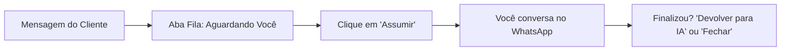

# Manual do Usuário — AtendeMy CRM (Guia Básico Operacional)

> **Versão:** 2.0  
> **Para quem é este manual:** Atendentes, Vendedores, Recepcionistas, Operadores de Suporte e toda a equipe que utiliza o sistema no dia a dia.  
> **Objetivo:** Ensinar o passo a passo completo de como operar o AtendeMy CRM na rotina de atendimento, vendas, agendamentos e tarefas, trabalhando em perfeita sintonia com a Inteligência Artificial.

---

## Sumário
1. [Acesso à Plataforma e Primeiro Login](#1-acesso-à-plataforma-e-primeiro-login)
2. [Conhecendo a Interface de Trabalho](#2-conhecendo-a-interface-de-trabalho)
3. [Operação do Inbox (Atendimento WhatsApp em Tempo Real)](#3-operação-do-inbox-atendimento-whatsapp-em-tempo-real)
4. [Trabalhando em Dupla com a Inteligência Artificial (Handoff)](#4-trabalhando-em-dupla-com-a-inteligência-artificial-handoff)
5. [Organização do Contato: Etiquetas, Notas Internas e Transferência](#5-organização-do-contato-etiquetas-notas-internas-e-transferência)
6. [Respostas Rápidas com Atalho "/" (Templates)](#6-respostas-rápidas-com-atalho--templates)
7. [Radar de Atendimento (Resgate de Conversas Frias)](#7-radar-de-atendimento-resgate-de-conversas-frias)
8. [Funil de Vendas e CRM (Kanban)](#8-funil-de-vendas-e-crm-kanban)
9. [Agenda de Compromissos e Visitas](#9-agenda-de-compromissos-e-visitas)
10. [Gestão de Tarefas e Lembretes Diários](#10-gestão-de-tarefas-e-lembretes-diários)
11. [Guia de Solução de Dúvidas Frequentes](#11-guia-de-solução-de-dúvidas-frequentes)

---

## 1. Acesso à Plataforma e Primeiro Login

### Passo a passo para entrar:
1. Abra seu navegador de internet preferido (Google Chrome ou Microsoft Edge recomendados).
2. Digite o endereço do CRM: **`https://crm.atendemy.com.br`** (ou o link específico fornecido pela sua empresa).
3. Na tela inicial de login, você tem duas opções de entrada:
   * **Opção A (E-mail e Senha):** Digite seu e-mail cadastrado e sua senha. Clique no botão azul **Entrar**.
   * **Opção B (Conta Google):** Se o seu e-mail corporativo for do Google/Gmail, basta clicar no botão **"Continuar com Google"** e selecionar sua conta.
4. **Esqueceu sua senha?**  
   Clique no link *"Esqueci minha senha"*, digite seu e-mail e você receberá na hora um link para redefinir sua senha com segurança.

---

## 2. Conhecendo a Interface de Trabalho

Ao fazer login, você terá acesso ao painel principal:

* **Menu Lateral Esquerdo:** Onde você encontra todos os módulos:
  * **Atendimento:** Inbox, Radar, Agenda e Respostas Rápidas.
  * **CRM:** Funis de Vendas (Kanban), Contatos, Tarefas e Propostas.
  * **Configurações:** Seu perfil pessoal e dados da sua conta.
* **Barra Superior:**
  * **Alternador de Empresa:** Se você trabalha em mais de uma unidade ou negócio, alterne com 1 clique no canto superior esquerdo.
  * **Busca Global (`Ctrl + K`):** Localize qualquer cliente, telefone ou negócio instantaneamente digitando o nome ou número.
  * **Perfil e Modo Escuro/Claro:** Alterne as cores da tela ou saia do sistema no canto superior direito.

---

## 3. Operação do Inbox (Atendimento WhatsApp em Tempo Real)

O **Inbox** (`Atendimento → Inbox` ou acesse `/app/inbox`) é onde todas as mensagens de WhatsApp, Instagram e Facebook chegam em tempo real.



### 3.1. Entendendo as Abas de Conversas (Topo da Lista)
No painel esquerdo do Inbox você verá 4 abas essenciais:
* **Fila:** Clientes que pediram para falar com uma pessoa ou cujo atendimento automático da IA encerrou e precisa de uma ação humana urgente. **Dê prioridade sempre a esta aba!**
* **Minhas:** Todas as conversas que estão sob sua responsabilidade no momento.
* **Todas:** Visão geral de todos os atendimentos da empresa (incluindo os que a IA está tocando sozinha).
* **Fechadas:** Histórico de conversas já resolvidas e arquivadas.

### 3.2. Como responder o cliente no chat:
1. Clique sobre a conversa desejada na lista.
2. Na caixa de digitação inferior:
   * **Mensagem de Texto:** Digite seu texto e aperte `Enter` para enviar.
   * **Áudio:** Clique no ícone de microfone, fale e clique em enviar (o áudio é gravado com clareza cristalina direto pelo navegador).
   * **Fotos, Vídeos e PDFs:** Clique no ícone de clipe de papel e selecione os arquivos do seu computador.
   * **Emojis e Figurinhas:** Use o botão de emoji para deixar o atendimento mais humanizado e descontraído.

---

## 4. Trabalhando em Dupla com a Inteligência Artificial (Handoff)

No AtendeMy, você não compete com o robô: vocês trabalham juntos. O robô faz a triagem inicial e qualificação, e você entra para fechar a venda ou tirar dúvidas específicas.

### 4.1. Como assumir uma conversa que a IA está atendendo:
1. No topo da janela de chat, você verá um aviso indicando que a IA está respondendo.
2. Clique no botão **"Assumir Atendimento"**.
3. **O que acontece:** A IA é **pausada instantaneamente** para aquele cliente. Ela não enviará nenhuma mensagem enquanto você estiver com o controle da conversa.
4. Digite e converse livremente com o cliente.

### 4.2. Como devolver a conversa para a IA:
Quando você já tiver resolvido a dúvida do cliente e quiser que a IA continue tirando dúvidas gerais ou fazendo follow-up:
1. No topo do chat, clique no botão **"Devolver para IA"**.
2. A partir desse momento, a IA volta a responder as novas dúvidas do cliente de forma automática.

### 4.3. Como finalizar/fechar uma conversa:
Quando o assunto estiver 100% resolvido:
1. Clique no botão **"Fechar Conversa"** (ou ícone de check).
2. A conversa sai da sua lista de abertas e vai para o arquivo. Se o cliente mandar um novo "Oi" no futuro, a conversa reabre automaticamente sem perder o histórico.

---

## 5. Organização do Contato: Etiquetas, Notas Internas e Transferência

Na lateral direita da tela de chat, você tem acesso à ficha viva do cliente:

### 5.1. Adicionando Etiquetas (Tags)
As etiquetas ajudam a categorizar o perfil do cliente com facilidade:
1. Na barra lateral direita, localize a seção **Etiquetas**.
2. Clique em **+ Adicionar** e selecione marcadores como:
   * `Lead Quente`
   * `Orçamento Enviado`
   * `Aguardando Pagamento`
   * `Contrato Fechado`
3. Você pode remover uma etiqueta a qualquer momento clicando no "X" ao lado dela.

### 5.2. Criando Notas Internas (Privadas para a Equipe)
Notas internas servem para deixar avisos para outros colegas de equipe sem que o cliente veja no WhatsApp:
1. Na barra lateral direita, clique na aba **Notas**.
2. Digite o recado. Exemplo:  
   *"Cliente informou que tem preferência por locação no sábado à tarde. Já enviei a tabela com desconto de 10%."*
3. Clique em **Salvar Nota**.  
   > 🔒 **Importante:** O cliente **NUNCA** recebe as notas internas. Elas ficam visíveis apenas para os atendentes logados no sistema.

### 5.3. Transferindo para outro Atendente
1. No topo da conversa, clique no menu de opções (três pontinhos) ou no avatar do responsável.
2. Selecione **Transferir Atendimento**.
3. Escolha o colega de equipe na lista.
4. A conversa sairá da sua aba "Minhas" e aparecerá imediatamente na tela do colega escolhido.

---

## 6. Respostas Rápidas com Atalho "/" (Templates)

Para não perder tempo digitando textos repetitivos (endereço, chave Pix, catálogo, políticas de cancelamento):

1. Vá em `Atendimento → Respostas rápidas` (`/app/templates`) para conferir as mensagens prontas salvas.
2. **Como usar no meio do chat:**
   * No campo de mensagem do cliente, digite apenas uma barra: **`/`**
   * Uma lista suspensa com todas as respostas prontas aparecerá na tela.
   * Comece a digitar o atalho (ex: `/pix`, `/endereco`, `/tabela`).
   * Pressione `Enter` e o texto completo será preenchido automaticamente!
   * Revise se quiser alterar algum detalhe e clique em Enviar.

---

## 7. Radar de Atendimento (Resgate de Conversas Frias)

Acesse `Atendimento → Radar` (`/app/radar`).

* **Para que serve:** O Radar monitora todas as conversas e identifica clientes que foram deixados sem resposta ou que pararam de responder há algum tempo.
* **Cores de Alerta:**
  * 🔴 **Vermelho:** Atendimento crítico parado há muitas horas ou dias.
  * 🟡 **Amarelo:** Atendimento esfriando que merece atenção hoje.
* **Como agir:** Clique direto sobre o card do cliente no Radar para abrir o chat correspondente e resgatar a venda antes que o cliente vá para o concorrente.

---

## 8. Funil de Vendas e CRM (Kanban)

Acesse `CRM → Funis` (`/app/kanban`).

O funil organiza visualmente as oportunidades em colunas:

```
[ Novo Contato ]  ➔  [ Visita Agendada ]  ➔  [ Proposta Enviada ]  ➔  [ Fechado / Ganho ]
```

### 8.1. Como criar um novo negócio no funil:
1. No topo da coluna correspondente (geralmente a primeira, ex: *Novo Lead*), clique em **+ Novo Negócio**.
2. Selecione o **Cliente** (busque pelo nome ou telefone).
3. Preencha o **Título** da oportunidade (ex: *Locação Aniversário 15 Anos - Fábio*).
4. Informe o **Valor estimado** (`R$`).
5. Clique em **Salvar**.

### 8.2. Movimentando as etapas da venda:
* Para avançar o cliente de fase, basta clicar no card dele, segurar e **arrastar para a coluna ao lado**.
* **Registrando Ganho 🎉:** Quando o contrato for assinado e o pagamento confirmado, arraste o card para a coluna **Ganho**. O valor entrará imediatamente nos relatórios de faturamento da empresa.
* **Registrando Perda ❌:** Se o cliente desistir, arraste para **Perdido** e selecione o motivo real (ex: *Achou caro*, *Data indisponível*, *Fechou com outro*). Isso ajuda a empresa a melhorar o produto.

---

## 9. Agenda de Compromissos e Visitas

Acesse `Atendimento → Agenda` (`/app/agenda`).

A agenda do AtendeMy sincroniza em duas vias com o **Google Calendar** da sua empresa. Quando um horário é reservado aqui, ele bloqueia no Google Agenda; quando alguém marca algo no Google Agenda, o AtendeMy bloqueia a data para não haver agendamentos duplicados.

### 9.1. Como agendar um compromisso manualmente:
1. Clique no botão azul **"Novo Agendamento"** no canto superior direito (ou clique diretamente no dia/horário vago da grade).
2. Selecione o **Tipo de Agendamento** (ex: *Reserva Espaço Lazer*, *Visita Presencial*, *Reunião de Alinhamento*).
3. Selecione o **Cliente** associado.
4. Defina a **Data de Início, Horário e Término**.
5. Escolha o **Profissional Responsável** que irá atender.
6. Clique em **Confirmar Agendamento**.
   * O sistema salva no CRM, atualiza o Google Calendar do atendente e pode disparar um lembrete automático no WhatsApp do cliente.

---

## 10. Gestão de Tarefas e Lembretes Diários

Acesse `CRM → Tarefas` (`/app/tasks`).

* **O que é:** Sua lista pessoal de afazeres para não esquecer nenhum compromisso de trabalho.
* **Como criar:**
  1. Clique em **Nova Tarefa**.
  2. Digite a descrição (ex: *"Cobrar comprovante de pagamento de Carla"* ou *"Ligar para confirmar número de convidados"*).
  3. Vincule ao contato correspondente.
  4. Defina o prazo final (Data e Hora).
* **Concluindo:** Ao finalizar a ação, basta marcar a caixinha redonda ao lado da tarefa. Ela será riscada e contabilizada no seu histórico de produtividade.

---

## 11. Guia de Solução de Dúvidas Frequentes

| Situação | Causa Provável | Solução |
|---|---|---|
| **A IA está respondendo enquanto eu tento falar** | O atendimento ainda não foi assumido por você. | Clique no botão **"Assumir Atendimento"** no topo do chat. |
| **O cliente mandou áudio e não consigo ouvir** | Áudio ainda processando ou volume do navegador mudo. | Verifique o som do computador ou clique com botão direito no áudio para recarregar. |
| **Não encontro um cliente antigo na lista** | A conversa pode ter sido fechada anteriormente. | Clique na aba **"Fechadas"** ou use a busca global (`Ctrl + K`) digitando o telefone dele. |
| **Apareceu uma tarja vermelha "Conexão desconectada"** | O aparelho celular do WhatsApp perdeu internet ou deslogou. | Avise imediatamente o gestor ou administrador da empresa para escanear o QR Code em *Canais*. |
| **Quero agendar uma data para daqui a 4 ou 5 meses** | Janela de agendamento do sistema. | O sistema está configurado para ler até **180 dias para frente**. Pode avançar o mês normalmente na grade! |

